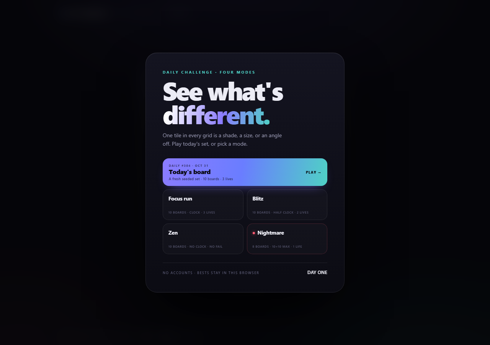

# Afterimage

**A visual perception gauntlet with a daily challenge — installable and offline.** One tile in every grid is a shade, a size, or an angle off. Take today's seeded set, or pick a mode and set your own pressure.



## Play

No dependencies and no build step. From this folder:

```bash
python -m http.server 8139
```

Open <http://127.0.0.1:8139/>. On Windows, double-click `PLAY.bat`.

Deep links: `/?mode=daily`, `/?mode=focus`, `/?mode=blitz`, `/?mode=zen`, `/?mode=nightmare`.

## Install & offline

Afterimage is a PWA. Served from `localhost` (a secure context), Chromium and Edge offer **Install app**; installed, it runs standalone with no browser chrome. A service worker caches the shell on the first visit, so the game keeps working offline — including today's seeded daily.

Open the page once to install the worker, reload once to be controlled, then use the browser's install action. Service workers require `localhost` or HTTPS; for a phone, serve the folder over HTTPS (or a tunnel) rather than a plain LAN IP.

The cache name lives in `sw.js`; bump `CACHE` whenever a cached asset changes.

## Daily challenge

The card at the top is seeded by your local date: **the same ten boards all day**, a three-life clock run, and a streak that grows each day you finish one. The menu keeps your best score for today; replays are allowed but only improve the day's best. Two fresh starts produce identical pixels — the seed is a small mulberry32 PRNG hashed from `YYYY-MM-DD`.

## Modes

| Mode | Boards | Pressure |
| --- | --- | --- |
| Focus run | 10 | clock, three lives |
| Blitz | 10 | half clock, two lives, 1.5× score |
| Zen | 10 | no clock, no fail |
| Nightmare | 8 | up to 10×10, one life, 2× score |

Every board hides one tile that differs by **hue, lightness, saturation, size or angle**. Focus, Blitz and Nightmare keep a personal best in `localStorage`; Zen has no clock, so it keeps none. A perfect run earns **EAGLE EYE**, **QUICK EYE** or **NIGHT VISION** depending on the mode.

`Tab` and the arrow keys move between tiles, `Enter` picks one. `Quit run` leaves any mode; `Skip level` appears in Zen.


## Score card

Every result can be saved as a **1200 × 630 PNG**, drawn on a second canvas: score, rating, stats and a mini board. Daily cards add the date and their daily number.


## Share the result

The result screen logs every board and shows the pattern as colored squares:

- 🟩 first-try clear
- 🟨 clear after a wrong click
- 🟥 timeout
- ⬜ skipped in Zen
- ⬛ untouched

**Copy result** writes the same pattern as text, ready to paste. A perfect daily would copy as:

```text
Afterimage Daily #304 · EAGLE EYE
2,300 · 10/10 · 100%
🟩🟩🟩🟩🟩🟩🟩🟩🟩🟩
Find the tile that doesn't belong.
```

## Why it exists

Afterimage doubles as a **testbed for multimodal agents**. The answer is never written into the DOM: the grid is painted on a canvas, and the only interactive elements are transparent hit areas labelled `Row N, column M`. To play, an agent has to read the rendered pixels and click the tile it believes is different.

I played a full Zen run this way, exporting the board after every round:

> **10/10 cleared · 100% accuracy · 2,300 points · EAGLE EYE**

The run caught two real bugs that the screenshots made obvious: burst particles leaking into the next board, and an empty "FOCUS" label in Zen. The daily seed is verified the same way: two independent starts hash to the same canvas. A later test of the wrong-click paths caught a missing `shake()` in the engine rewrite; recovery and fatal-miss results are now covered end to end.

## Under the hood

- Vanilla HTML, CSS and JavaScript. One render canvas, one favicon, no game assets.
- Four mode configs plus the daily challenge drive two level scripts; Nightmare's script runs from 8×8 to 10×10.
- `game.js` holds the palette generator, seeded PRNG, DPR-aware renderer, hit-testing, scoring and WebAudio blips.
- Daily puzzles use mulberry32 seeded from the local date; the daily result and streak live under `afterimage.daily`.
- Each board logs green/gold/red/skip/dark for the result strip and copied text; the clipboard uses the async API with a textarea fallback.
- A service worker caches the shell; navigations are network-first with a cached-index fallback on failure **or non-OK responses**, assets are cache-first with a background refresh.
- The manifest adds standalone display, maskable icons and Daily/Nightmare shortcuts.
- Per-mode bests are stored as JSON, with the old single best migrated.
- A run token (`runId`) guards late `setTimeout` callbacks after quitting; particles are cleared between boards.
- Respects `prefers-reduced-motion`; storage and audio failures are non-fatal.

## Files

| File | Role |
| --- | --- |
| `index.html` | shell, HUD, menu and result cards |
| `styles.css` | layout, glass panels, responsive rules |
| `game.js` | the game, score-card renderer and share text |
| `manifest.json` | PWA name, icons, shortcuts and standalone display |
| `sw.js` | offline shell and cache policy |
| `icons/` | 192/512/maskable/touch icons |
| `tools/make_icons.py` | regenerate the PNG icons (Pillow, dev only) |
| `PLAY.bat` | Windows launcher |
| `assets/` | screenshots and score card |

---

A `portable_agent_kit` playground project. Not published.
