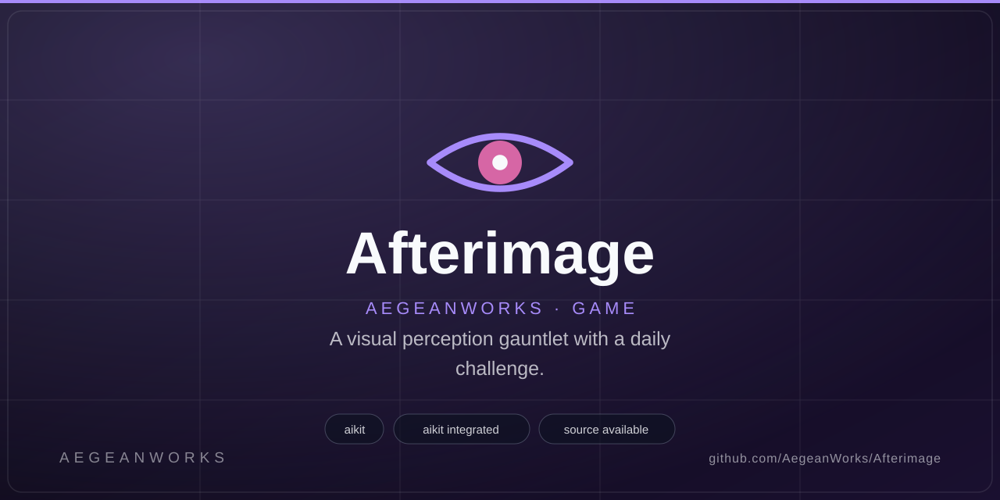
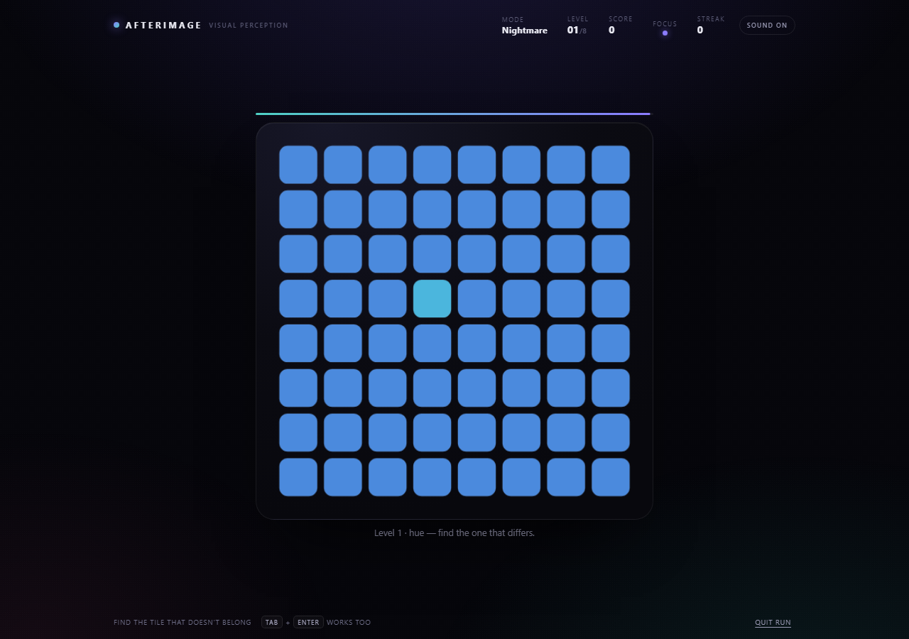
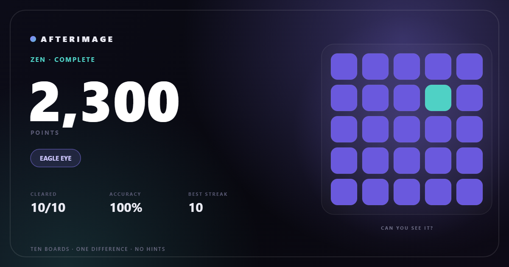
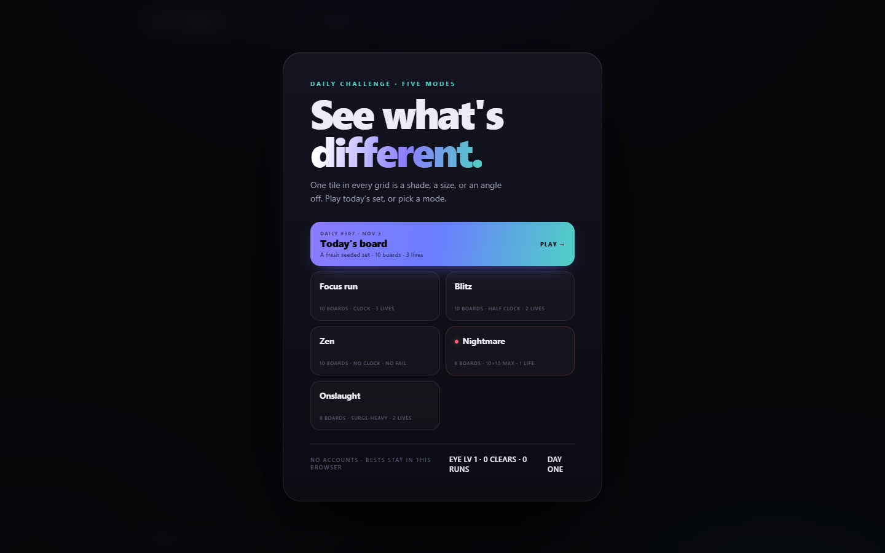
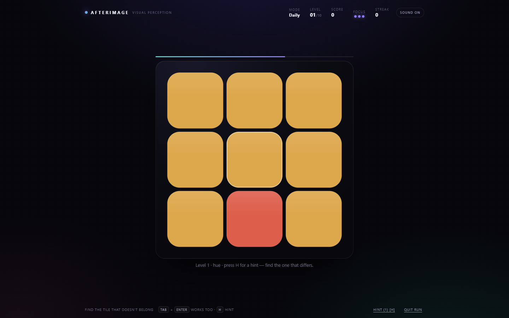

# Afterimage

<!-- aegean:media:start -->
<p align="center"></p>
<p align="center"><a href="LICENSE"></a> <a href="https://github.com/AegeanWorks/AIKit"></a></p>
<!-- aegean:media:end -->

A visual perception gauntlet with a daily challenge: one tile in every grid is a shade, a size, or an angle off. Installable, offline-capable PWA.

## ⚡ 30-Second Cold-Start Quick Reference

- **Runtime Prerequisites**: Node.js 20 or newer for test runner and tools; modern browser with HTML5 Canvas and WebAudio for playing.
- **Canonical Regression Shield Gate**:
  ```bash
  node --test tests
  ```

### 🛠️ AIKit Commands (run from the AIKit folder)
| Role | Command |
|---|---|
| Status, task and gates | `python aikit.py status afterimage` |
| Phase 4: every gate | `python aikit.py check afterimage` |
| Repair memory and map, then check | `python aikit.py fix afterimage` |
| Resume an interrupted task | `python aikit.py resume afterimage` |

## Play

No dependencies and no build step. From this folder:

```bash
python -m http.server 8139
```

Open <http://127.0.0.1:8139/>. On Windows, double-click `PLAY.bat`.

Deep links: `/?mode=daily`, `/?mode=focus`, `/?mode=blitz`, `/?mode=zen`, `/?mode=nightmare`, `/?mode=onslaught`.

## Install & offline

Afterimage is a PWA. Served from `localhost` (a secure context), Chromium and Edge offer **Install app**; installed, it runs standalone with no browser chrome. A service worker caches the shell on the first visit, so the game keeps working offline — including today's seeded daily.

Open the page once to install the worker, reload once to be controlled, then use the browser's install action. Service workers require `localhost` or HTTPS; for a phone, serve the folder over HTTPS (or a tunnel) rather than a plain LAN IP.

The cache name lives in `sw.js`; bump `CACHE` whenever a cached asset changes.

## Daily challenge

The card at the top is seeded by your local date: **the same ten boards all day**, a three-life clock run, and a streak that grows each day you finish one. Only a completed daily advances the streak: a lost run leaves it *at risk* until a same-day replay clears the board. The menu keeps your best result for today: a completed run always outranks a higher-scoring loss, and **New daily best** only appears on a win. Replays are allowed but only improve the day's best. Two fresh starts produce identical pixels — the seed is a small mulberry32 PRNG hashed from `YYYY-MM-DD`.

## Modes

| Mode | Boards | Pressure |
| --- | --- | --- |
| Focus run | 10 | clock, three lives |
| Blitz | 10 | half clock, two lives, 1.5× score |
| Zen | 10 | no clock, no fail |
| Nightmare | 8 | up to 10×10, one life, 2× score |
| Onslaught | 8 | surge-heavy, 2 lives, 1.25× score |

Every board hides one tile that differs by **hue, lightness, saturation, size or angle**. Focus, Blitz, Nightmare and Onslaught keep a personal best in `localStorage`; Zen has no clock, so it keeps none. A perfect run earns **EAGLE EYE** (Focus, Zen, Onslaught, Daily), **QUICK EYE** (Blitz) or **NIGHT VISION** (Nightmare).

`Tab` and the arrow keys move between tiles, `Enter` picks one. `Quit run` leaves any mode; `Skip level` appears in Zen. When a run ends the result card itself takes focus, so its title is announced; returning to the menu from a result (**Change mode**) or a run (**Quit run**) focuses Today's board, so keyboard play continues without tabbing from the top.



## Score card

Every result can be saved as a **1200 × 630 PNG**, drawn on a second canvas: score, rating, stats and a mini board. Daily cards add the date and their daily number. If the browser cannot build the card, the result screen explains the failure and points to **Copy result** instead of failing silently.

## Addictivity systems

- **Combo tiers**: streaks pay escalating multipliers — COMBO (2+, 1.1×), FEVER (4+, 1.25×), BLAZE (6+, 1.5×) — with a rising correct-answer pitch and a hot streak badge.
- **Perfect bonus**: clearing a board at first glance without a hint adds +50 before multipliers.
- **Local payoff**: every correct pick pops its points at the tile, and shape boards burst in accent teal so the win lands where you clicked.
- **Audio grammar**: a wrong pick is one low buzz, a timeout is a descending three-note fall, a win is a rising arpeggio, and a loss is a low two-note fall — outcomes are audible before the result is read.
- **Boss beat**: the last board of every run wears a gold FINAL BOARD badge and stage glow, so the climax is visible before the clock starts.
- **SURGE boards**: scripted bonus boards (two per classic run) pay 1.5×, are announced up front, and carry a persistent SURGE badge for the whole board.
- **Hints**: press `H` or the Hint button — 1 per timed run, 3 in Zen. A pulsing ring marks the odd tile for ~2s at the cost of a streak reset.
- **Comeback assist**: after two straight non-green boards the next difference is eased ~30%, keeping struggling runs in the flow channel instead of rage-quitting.
- **Eye Levels**: total clears feed a local profile (`afterimage.profile`) — every 10 clears raises your EYE LV, shown in the menu.
- **Rebalanced curve**: the final classic boards now tighten monotonically (6×6/15 → 6×6/15° → 7×7/13) instead of loosening at the end.
- **Shareable proof**: copied results and score cards carry the best combo (`BLAZE ×10`) and perfect-board count, so skilled runs advertise themselves.
- **Near-miss feedback**: a wrong pick orthogonally next to the odd tile says so ("So close — it was next door") instead of a flat rejection, keeping unlucky runs warm.
- **Fair reveal**: a fatal miss dims the board and marks the odd tile for a beat before the result, matching the timeout reveal so every lost run teaches the answer.
- **First-run coach**: the very first board of a new player's first run names the `H` hint; the last three clock seconds tick audibly.
- **Goal-gradient beats**: level callouts mark "halfway", "two left" and "final board" so the end pulls players forward.
- **Weakest-link debrief**: misses are tracked per puzzle type and the result blurb names the costliest one ("Angle boards cost you most — Zen is a good place to study them"), turning failure into a practice plan. The menu also shows lifetime runs next to EYE LV.
- **Best-pace chase**: timed runs compare your live score against your personal (or daily) best pro-rata and call out "best pace!" once when you cross it — a rabbit to chase every board.
- **Streak-earned hints**: a daily streak of 3+ days grants a bonus hint in the daily run, and streaks of 3/7+ days earn ROLLING/UNSTOPPABLE labels — consistency pays visibly.
- **Streak freeze**: a perfect daily win (cleared, 100% accuracy) earns one freeze — miss exactly one day and the streak survives, consuming the freeze. The menu shows "freeze armed" while one is held.
- **Mode mastery**: per-mode win counts persist locally; cleared modes wear a CLEARED badge next to their best, and a first clear of any mode gets its own result callout.



## Share the result

The result screen logs every board and shows the pattern as colored squares:

- 🟩 first-try clear
- 🟨 clear after a wrong click
- 🟥 timeout
- ⬜ skipped in Zen
- ⬛ untouched

**Copy result** writes the same pattern as text, ready to paste. If the clipboard is blocked, the share text opens selected in a read-only box with a Close action, so the result can still be copied by hand. A perfect daily cleared with full clock to spare would copy as:

```text
Afterimage Daily #304 · EAGLE EYE
5,580 · 10/10 · 100% · BLAZE ×10 · 10 perfects · 2 surges
🟩🟩🟩🟩🟩🟩🟩🟩🟩🟩
Find the tile that doesn't belong.
```

(The 5,580 figure is the verified full-clock ceiling for a perfect Focus-script run: 270+330+350+660+500+600+600+930+650+690. Real runs score less — the combo and perfect segments are the bragging rights.)

## Why it exists

Afterimage doubles as a **testbed for multimodal agents**. The answer is never written into the DOM: the grid is painted on a canvas, and the only interactive elements are transparent hit areas labelled `Row N, column M`. To play, an agent has to read the rendered pixels and click the tile it believes is different.

I played a full Zen run this way, exporting the board after every round:

> **10/10 cleared · 100% accuracy · 2,300 points · EAGLE EYE**

The run caught two real bugs that the screenshots made obvious: burst particles leaking into the next board, and an empty "FOCUS" label in Zen. The daily seed is verified the same way: two independent starts hash to the same canvas. A later test of the wrong-click paths caught a missing `shake()` in the engine rewrite; recovery and fatal-miss results are now covered end to end.

## Under the hood

- Vanilla HTML, CSS and JavaScript. One render canvas, one favicon, no game assets.
- Five mode configs plus the daily challenge drive three level scripts; Nightmare's script runs from 8×8 to 10×10.
- `game.js` holds the palette generator, seeded PRNG, DPR-aware renderer, hit-testing, scoring and WebAudio blips.
- Daily puzzles use mulberry32 seeded from the local date; the daily result and streak live under `afterimage.daily`, and saved results are validated on load so malformed records cannot break the menu or a daily deep link.
- Each board logs green/gold/red/skip/dark for the result strip and copied text; the clipboard uses the async API with a textarea fallback.
- A service worker caches the shell; navigations are network-first with a cached-index fallback on failure **or non-OK responses**, assets are cache-first with a background refresh.
- The manifest adds standalone display, maskable icons and Daily/Nightmare/Onslaught shortcuts.
- Per-mode bests are stored as JSON, with the old single best migrated.
- A run token (`runId`) guards late `setTimeout` callbacks after quitting; particles are cleared between boards.
- Respects `prefers-reduced-motion`; storage and audio failures are non-fatal.
- On phones the topbar wraps: brand and sound share the first row, all five HUD values share the second, and play never scrolls sideways.

## 📦 What's Inside

```text
afterimage/
├── .gitignore                <- transient AIKit state excluded
├── ASSETS.md                 <- Asset/data manifest: what the license covers
├── COMMERCIAL.md             <- Commercial licensing terms
├── LICENSE                   <- Aegean Game License 1.1 (AGL-1.1): DRM-free personal play
├── LICENSES/                 <- REUSE license texts
├── package.json              <- project metadata and test runner scripts
├── PLAY.bat                  <- Windows launcher
├── README.md
├── REUSE.toml                <- Machine-readable SPDX metadata
├── assets/                   <- screenshots, icons, and media artwork
├── favicon.svg               <- vector browser tab favicon
├── game.js                   <- game engine, PRNG, renderer and mechanics
├── icons/                    <- PWA application icons
├── index.html                <- game markup, HUD and modal templates
├── manifest.json             <- Web App Manifest for PWA installation
├── styles.css                <- responsive styling and layout
├── sw.js                     <- service worker for offline shell caching
├── tests/                    <- automated behavioral and regression tests
├── tools/                    <- icon generation scripts
└── .aikit/                   <- this project's memory: record, ledger, decisions
```

## 🧪 Tests

```bash
node --test tests
```

`tests/harness.js` stubs the browser environment (DOM elements, canvas, ResizeObserver, localStorage) and loads `game.js` inside `node:vm` without opening network ports. `tests/game.test.js` covers PRNG determinism, daily date hashing, scripts and modes configuration, board round generation with odd-tile verification, score calculation, performance ratings, and share card formatting.

<!-- aegean:brand-assets:start -->
## 🎨 Brand Assets

> **AI-Generated Brand Artwork.** The banner and logo are **AI-generated brand assets**. They are illustrative and may not literally depict every feature or the full project scope.
<!-- aegean:brand-assets:end -->

## 📜 License

<!-- aegean:license:start -->
Free for personal play under the Aegean Game License 1.1 (AGL-1.1); see [LICENSE](LICENSE). It is DRM-free: Licensor ships no DRM and a distributor may not add it. Streaming, modding and free mods are allowed. Commercial use, paid mods and AI training need the Aegean Commercial License 1.0 (ACL-1.0); see [COMMERCIAL.md](COMMERCIAL.md).
<!-- aegean:license:end -->

<!-- aegean:screenshots:start -->
## Screenshots

<a href="https://github.com/AegeanWorks/Afterimage/commit/5be4c63"></a>

<a href="https://github.com/AegeanWorks/Afterimage/commit/5be4c63"></a>

*commit `5be4c63` · 2026-11-03 · viewport 1440x900 · legacy `assets/menu.png` (four modes, daily #304) superseded after Onslaught*
<!-- aegean:screenshots:end -->
